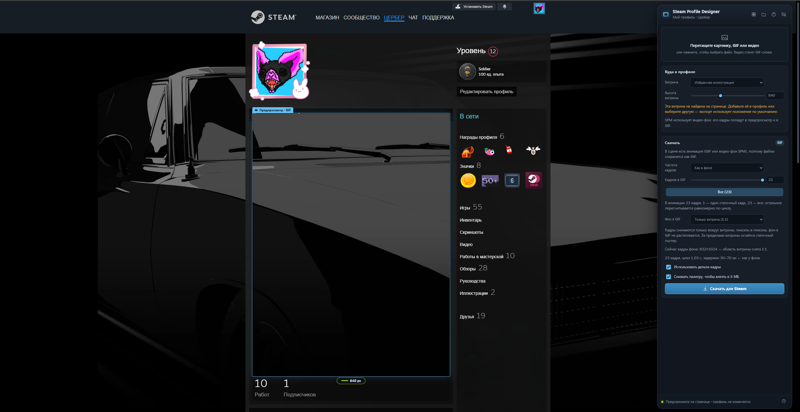
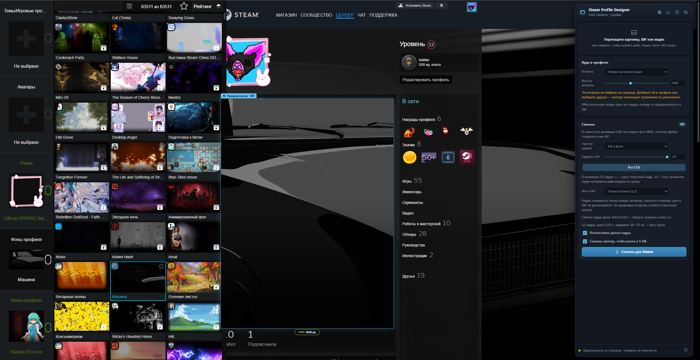

# Steam Profile Designer

[](https://developer.chrome.com/docs/extensions/develop/migrate/what-is-mv3)
[](#поддержка-браузеров)
[](LICENSE)
[](https://chromewebstore.google.com/detail/steam-profile-modifier/lfjdaphbejfpncjfebkbcganmkinhhfl)

Расширение для Chrome, Microsoft Edge и Chromium (Manifest V3), которое накладывает ваши картинки и GIF на настоящую страницу профиля Steam, позволяет подогнать их мышью и скачивает готовые файлы для витрин. Всё работает локально в браузере: без сервера, аккаунтов и Steam API Key.

## Работает вместе со Steam Profile Modifier

Расширение рассчитано на связку со [Steam Profile Modifier (SPM)](https://chromewebstore.google.com/detail/steam-profile-modifier/lfjdaphbejfpncjfebkbcganmkinhhfl):

- SPM ставит фон и анимированный видео-фон профиля — дизайнер читает их как есть и **не перезаписывает**.
- Видео-фон SPM попадает в предпросмотр и в экспортируемый GIF: кадры снимаются покадрово, с выбором длинной стороны 360–1920 px или области витрины 1:1.
- Слои и прозрачные окна рисуются поверх, а вырезанный фон витрины остаётся фоном страницы.
- Если видео закрыто CORS, используются CORS-клон и relay через service worker расширения; при неудаче остаётся постер с предупреждением.

SPM не обязателен: без него расширение работает с обычным фоном Steam и вашими файлами.

## Скриншоты

**Живой предпросмотр на профиле.** Композиция рисуется поверх выбранной витрины, а панель справа управляет витриной, кадрами GIF и разрешением фона.



**Вместе со Steam Profile Modifier.** Слева открыт каталог тем и фонов SPM, справа — панель дизайнера: видео-фон профиля попадает в предпросмотр и GIF.



## Установка

Готовая сборка лежит в [Releases](https://github.com/222tihomir/Steam-Profile-Designer/releases). Отдельная установка из исходников не нужна — достаточно распаковать ZIP. Один и тот же архив подходит для Chrome, Edge и Chromium.

1. Скачайте `Steam-Profile-Designer-*.zip` из последнего релиза и распакуйте в постоянную папку (браузер читает расширение прямо из неё).
2. Откройте страницу расширений: `chrome://extensions` в Chrome и Chromium или `edge://extensions` в Microsoft Edge.
3. Включите «Режим разработчика».
4. Нажмите «Загрузить распакованное расширение» (в Edge — «Загрузить распакованное») и выберите распакованную папку — внутри должен лежать `manifest.json`.
5. Откройте свой профиль на `steamcommunity.com` и нажмите иконку расширения.

После обновления релиза папку нужно заменить целиком и нажать «Обновить» на карточке расширения. Проекты и настройки хранятся в IndexedDB браузера и при этом не теряются.

## Поддержка браузеров

Одна и та же сборка работает в Google Chrome, Microsoft Edge и Chromium: расширение использует Manifest V3 и только общий API `chrome.*`, без сервисов, привязанных к конкретному браузеру. Отдельные сборки не нужны.

| Браузер | Страница расширений | Установка |
| --- | --- | --- |
| Google Chrome | `chrome://extensions` | «Режим разработчика» → «Загрузить распакованное расширение» |
| Microsoft Edge | `edge://extensions` | «Режим разработчика» → «Загрузить распакованное» |
| Chromium | `chrome://extensions` | так же, как в Chrome |

Другие Chromium-браузеры (Brave, Vivaldi, Opera) тоже подходят — установка такая же. Встроенный браузер Steam-клиента расширения не поддерживает: профиль нужно открывать в настольном браузере.

В Chromium без проприетарных кодеков MP4 (H.264) может не декодироваться — для видео-слоёв используйте WebM; в Google Chrome и Edge доступны оба формата.

## Что умеет

- **Живой предпросмотр на профиле.** Композиция рисуется поверх места выбранной витрины, фон остаётся тем, который уже стоит на странице.
- **Совместимость со Steam Profile Modifier (SPM).** Расширение читает итоговый фон страницы, включая `backgroundImage`, который выставляет SPM, и не перезаписывает его, если фон проекта совпадает с фоном профиля. Анимированный видео-фон SPM читается покадрово в родной частоте, поэтому попадает в предпросмотр и в GIF без превращения в слайд-шоу. Если пиксели видео закрыты CORS, расширение сначала пробует CORS-клон элемента, затем релей через service worker расширения, и только после этого оставляет постер с явным предупреждением — «испорченные» кадры в энкодер не попадают.
- **Картинки и GIF.** PNG с прозрачностью, JPG, WebP и анимированные GIF. Кадры GIF сохраняются при экспорте.
- **Видео как слой.** Перетащите MP4 (H.264) или WebM — ролик сразу раскладывается в GIF-кадры (до 90 кадров, длинная сторона до 960 px) и ведёт себя как анимированный слой: двигается, масштабируется, попадает в предпросмотр и в готовый GIF. Оригинал остаётся в IndexedDB; при повторном открытии проекта кадры собираются заново с теми же ограничениями. Лимит файла — 120 МБ.
- **Вырезание сплошного фона.** У картинки, GIF или видео-слоя блок «Убрать фон» делает выбранный цвет прозрачным во всех кадрах. Цвет можно взять из угла первого кадра или задать вручную; «По краям» удаляет только фон, связанный с краем (белый квадрат внутри картинки останется), «Везде» — каждый пиксель этого цвета. Допуск расширяет захват, мягкий край сглаживает границу. Готовый вариант кешируется по настройкам, а экспорт дожидается обработки и не берёт исходный фон.
- **Видимый прогресс загрузки GIF.** Пока GIF читается, над панелью показывается полоса с именем файла и процентом (например, «8% · 5 / 60 кадров»), а в строке состояния — «Загружаю GIF: 8%». Для видео там же «Разбираю видео: N%». Большой файл разбирается сотни миллисекунд, поэтому панель не выглядит зависшей.
- **Подгонка мышью.** Перетаскивание слоя прямо на странице, колесо мыши меняет размер, угловые ручки тянут размер пропорционально. В простой панели есть точные поля ширины и высоты и отдельная высота самой витрины.
- **Несколько слоёв.** Список картинок, порядок, видимость и удаление. Верхний слой лежит поверх остальных.
- **Витрины Steam.** Избранная иллюстрация, витрина иллюстраций, скриншотов и мастерской. Положение каждой витрины измеряется на странице, поэтому порядок блоков в профиле не сбивает вырезку фона. Рамка предпросмотра равна настоящей картинке витрины, а координаты вырезки берутся из фактического прямоугольника фона (учитываются `background-size` и `background-position`), поэтому широкое окно не растягивает композицию. Экспорт нарезается на нужные части.
- **Прозрачное окно.** Необязательное окно в фоне: в нём виден настоящий фон страницы. Нужно для сложных композиций; в простом режиме можно обойтись без него.
- **Экспорт PNG/GIF и ZIP с прогрессом.** Готовые файлы, `files.json`, `README.txt` и необязательный `background_cutout.png`. Во время сборки видна полоса с процентом и текущим шагом («GIF, часть 1 из 1»). GIF ужимается под лимит Steam 5 МБ только по включённым галочкам «Использовать дельта-кадры» и «Снижать палитру». Скачивать можно и без картинок: тогда в файлах остаётся только фон витрины (при включённой галочке — ещё и `background_cutout.png`), а в `README.txt` появляется пометка об этом.
- **Частота кадров GIF и синхронизация с фоном.** «Как в фоне» сохраняет родной ритм анимированного фона, а 5, 10, 12,5, 20, 25 и 50 кадр/с пересобирают анимацию равномерно. Длительность цикла всегда равна одному циклу фона (или самого длинного GIF-слоя), поэтому готовый GIF не разъезжается с фоном на странице. Предпросмотр на живой странице идёт по часам самого `<video>` SPM: наложение и видимый фон остаются на одном кадре, а загрузка ассетов больше не сбрасывает анимацию на начало. Рядом есть выбор числа кадров «Кадров в GIF»: от 1 до числа кадров источника. «Все (N)» оставляет весь ряд, «24 (качество)» — быстрый пресет, если источник длиннее 24 кадров: меньше кадров оставляет полную палитру и детализацию вместо автоматического снижения цветов под лимит 5 МБ. Меньшее число кадров пересчитывается равномерно по циклу, поэтому длительность не меняется. Если кадров получается больше 120, частота автоматически снижается, а в предупреждении указана фактическая. Две отдельные галочки управляют сжатием: «Использовать дельта-кадры» пишет только изменившиеся пиксели и берёт одну общую палитру на всю анимацию — поэтому файл заметно меньше, а у движущихся объектов нет грязного контура; «Снижать палитру, чтобы влезть в 5 МБ» уменьшает число цветов при превышении лимита. По умолчанию обе выключены: тогда каждый кадр записывается полностью с заданной палитрой, а если файл больше 5 МБ — появляется предупреждение.
- **Качество видео-фона в GIF.** Выбор «Фон в GIF» задаёт, сколько деталей видео-фона попадёт в кадры. Числовые варианты 360, 480, 720, 960, 1080, 1440 и 1920 px ограничивают длинную сторону сэмплированного кадра: меньше число — легче файл и мягче фон, 1920 снимает в родном разрешении видео и никогда не растягивает его. «Только витрина (1:1)» обрезает кадры до области витрины и снимает её пиксель в пиксель — фон в GIF не растягивается, а за пределами витрины остаётся статичный постер. Под выбором показан фактический размер кадров фона: если исходное видео меньше выбранного значения, оно не растягивается, и это видно по числу.
- **Проекты.** Автосохранение в IndexedDB, список проектов, дублирование, переименование, импорт и экспорт `.spd.zip`.
- **Помощник загрузки.** На странице загрузки иллюстраций расширение подставляет нужные поля по имени файла и применяет GIF-патч трейлера.

## Сборка из исходников

Нужен Node.js 20+ и npm.

```bash
npm install
npm run dev
```

Студия откроется на `http://127.0.0.1:5173/`. В Windows PowerShell, если `npm` не находится в PATH, вызывайте `npm.cmd`:

```powershell
npm.cmd install
npm.cmd run dev
```

Откройте `http://127.0.0.1:5173/mock-profile.html#spd` — это локальная копия профиля Steam с уже открытой панелью. Хеш `#spdwide` включает широкое окно (контент 976 px по центру, фон 1920 px), `#spdnobg` убирает фон, `#spdvideo` включает видео-фон в стиле SPM из `public/mock/spm-clip.webm`, `#spdvideo-large` берёт клип 1200×800 из `public/mock/spm-clip-large.webm` (на нём видно, как работает выбор разрешения фона), а `#spdvideo-noposter` проверяет видео без картинки-постера. Для проверки загрузки используйте `http://127.0.0.1:5173/mock-upload.html`.

Сборка расширения:

```bash
npm run typecheck
npm test
npm run build
```

Готовые файлы появятся в `dist/`. Откройте `chrome://extensions` (Chrome/Chromium) или `edge://extensions` (Edge), включите режим разработчика, нажмите «Загрузить распакованное расширение» и выберите папку `dist`.

## Как пользоваться

1. Откройте свой профиль на `steamcommunity.com` и нажмите кнопку расширения.
2. Перетащите картинку, GIF или видео (MP4/WebM) в панель. Пока файл читается, над панелью виден прогресс с процентом и числом кадров.
3. Двигайте её мышью прямо на странице, колесом меняйте размер, угловыми ручками — пропорционально. Точные ширина и высота — в панели, высота самой витрины — там же или ручкой под рамкой. Чтобы убрать сплошной фон, раскройте «Убрать фон» под настройками слоя: цвет обычно подставляется из угла, дальше подстройте допуск и мягкий край.
4. Выберите витрину, на место которой должна лечь композиция. У каждой витрины своя вырезка фона, поэтому переключение не сдвигает готовые файлы.
5. Для GIF выберите частоту кадров в блоке «Скачать»: «Как в фоне» оставляет ритм источника, остальные значения пересобирают анимацию. Там же выберите число кадров «Кадров в GIF» от 1 до числа кадров источника: «Все (N)» оставляет весь ряд, «24 (качество)» задаёт быстрый пресет, если важнее не плавность, а сохранение цветов и деталей. Галочка «Использовать дельта-кадры» пишет только изменившиеся пиксели и берёт общую палитру на всю анимацию: файл выходит меньше, а вокруг движущихся объектов не появляется грязный контур. Галочка «Снижать палитру» автоматически уменьшает число цветов, когда файл не влезает в 5 МБ; без неё файл может превысить лимит и появится предупреждение. Выбор «Фон в GIF» управляет детализацией видео-фона: 360, 480, 720, 960, 1080, 1440 и 1920 px ограничивают длинную сторону кадра (меньше — мягче и легче), «Только витрина (1:1)» обрезает кадры вокруг витрины и не растягивает их. Под выбором показан фактический размер кадров фона (меньший исходник не растягивается), а также сколько кадров и с какой длительностью цикла получится.
6. Нажмите «Скачать для Steam». В ZIP будут готовые файлы и подсказка, что загружать. Картинку можно не добавлять: тогда скачается только фон витрины — удобно, если композицию вы собираете отдельно.
7. Загрузите файлы через страницу Steam и добавьте нужную витрину в профиль.

Кнопка со стрелками в заголовке панели открывает полную студию с фоновым холстом, окнами прозрачности, кадрированием и тонкими настройками экспорта.

## Загрузка в Steam: подсказки для консоли

Используйте сочетание клавиш **Ctrl+Shift+I** или **F12**, чтобы открыть консоль.

**Иллюстрации (artwork)** — [vsthemes.org/steam/artwork/75860-detailing-master.html](https://vsthemes.org/steam/artwork/75860-detailing-master.html)

Введите следующий код при загрузке **КАЖДОЙ (!)** картинки (загружать штучно, по отдельности):

```js
$J('#image_width').val(1000).attr('id',''),$J('#image_height').val(1).attr('id','');
```

Затем нажмите Enter.

Если видите ошибку — выполните требования, которые там указаны. Зачастую необходимо вручную напечатать «разрешить вставку», а затем повторно использовать код.

**Мастерская (workshop)** — [vsthemes.org/steam/workshop/76116-resize-dark-background.html](https://vsthemes.org/steam/workshop/76116-resize-dark-background.html)

Аналогично, при загрузке каждой картинки по отдельности:

```js
$J('[name=consumer_app_id]').val(480);$J('[name=file_type]').val(0);$J('[name=visibility]').val(0);
```

Затем нажмите Enter. Если видите ошибку — выполните требования, которые там указаны; зачастую нужно вручную напечатать «разрешить вставку» и повторно использовать код.

К каждой витрине — свой код: используйте фрагмент, который относится к её окну загрузки.

## Стек

- React 19 + TypeScript + Vite
- Canvas 2D для композиции
- `gifuct-js` для декодирования GIF, собственный совместимый с `gifenc` энкодер для кодирования (быстрый потоковый проход + квантование палитры)
- `jszip` для ZIP
- `idb-keyval` для IndexedDB

## Приватность

Все изображения, проекты и экспорт остаются в браузере. Расширение не отправляет файлы на сторонние серверы и не использует Steam API Key. Сетевые запросы нужны только для загрузки выбранных вами изображений и каталога фонов.

## Структура

```
src/editor/          панель, простая панель, студия, холст, модальные окна
src/shared/          геометрия Steam, рендер, экспорт, GIF, IndexedDB
src/shared/steam/    чтение профиля, фон, инвентарь, каталог, помощник загрузки
src/content/         content script, shadow DOM, launcher, помощник загрузки
public/              manifest.json и иконки
mock-profile.html    локальная копия профиля для разработки
mock-upload.html     локальная форма загрузки для помощника
```

## Ограничения

- Ширина фона Steam — 1920 px; экспорт всегда является вырезкой из этой системы координат, поэтому совпадает с настоящей страницей.
- Steam ограничивает файл иллюстрации 5 МБ. Для GIF есть две независимые галочки. «Использовать дельта-кадры» перестаёт перерисовывать неизменившиеся пиксели и собирает одну общую палитру на всю анимацию: кадр 0 записывает её как глобальную таблицу, остальные кадры на неё ссылаются. Общая палитра убирает грязный контур вокруг движущихся объектов (раньше каждый кадр считался в своей палитре, и сохранённые пиксели выбивались из нового окружения) и экономит по 768 байт локальной таблицы на кадр. Палитра строится по выборке до 24 кадров, поэтому на фотографическом видео она описывает цвета на 1–1,5 уровня грубее покадровой — незаметно рядом с выигрышем в весе. «Снижать палитру» уменьшает число цветов, пока файл не влезет в лимит. По умолчанию обе выключены: энкодер делает один проход с выбранной палитрой и пишет каждый кадр целиком. Это надёжнее после пережатия Steam, но лимит 5 МБ может быть превышен — тогда появится предупреждение. Пресет «24 (качество)» заранее ограничивает число кадров, чтобы палитра осталась полной; «Все (N)» и ползунок «Кадров в GIF» отдают плавность или промежуточный вариант.
- Анимированный фон SPM — это `<video>`. Расширение записывает один цикл видео и сохраняет все кадры, которые реально показывает браузер, поэтому в GIF попадает родная частота кадров, а не выборка 8 кадр/с. Лимит — 120 кадров. По умолчанию кадр сжимается до 960 px по длинной стороне; выбор «Фон в GIF» меняет это: варианты 360–1920 px задают длинную сторону сэмплированного кадра (без апскейла), «Только витрина (1:1)» обрезает кадры до области витрины, поэтому фон в GIF не растягивается. Фактический размер кадров виден под выбором: по нему сразу понятно, применилось ли разрешение или исходник меньше выбранного. Для длинных клипов используется равномерное сэмплирование по всей длине. Если при сэмплировании несколько раз попадается один и тот же кадр, повторы склеиваются в один кадр с общей задержкой, поэтому редкое видео не раздувается копиями. Задержки кадров берутся из времени видео, поэтому цикл совпадает с фоном. Видео без постера тоже поддерживается — кадры читаются прямо из элемента.
- **CORS и защита от «испорченного» холста.** Кадр видео проверяется через `getImageData(0,0,1,1)` перед регистрацией: Chrome разрешает `createImageBitmap` даже для холста, запятнанного чужим видео, и раньше ошибка всплывала только внутри GIF-энкодера («The canvas has been tainted by cross-origin data»). Если страница не даёт читать пиксели, расширение пробует тот же URL в отдельном `<video crossorigin="anonymous">`, затем скачивает клип через service worker расширения (у него есть host permissions) и проигрывает из blob-URL. Если не сработало ничего, в GIF попадает постер, а в README и интерфейсе появляется предупреждение, что движения не будет. Проверять чужие домены без CORS и без host permission бессмысленно — для них доступен только постер.
- GIF хранит задержки с точностью 10 мс. Расширение квантует их накопительно, чтобы сумма оставалась равна циклу фона (например, 20 кадров по 124 мс превращаются в чередование 120 и 130 мс, а не в 20 × 120 мс с отставанием). При выборе частоты кадров цикл всё равно заканчивается на границе цикла фона. Больше 120 кадров не кодируется: частота снижается, фактическое значение пишется в предупреждении.
- Если в сцене есть анимация (GIF-слой или видео-фон SPM), экспорт всегда GIF: PNG для такого проекта не будет молчаливой заменой. GIF на статичной сцене даёт один кадр.
- Видео-слой хранится в проекте как исходный клип, а в памяти и в GIF — как кадры. Для витрины это осознанное ограничение: Steam принимает только картинку или GIF. Клип длиннее ~3 секунд при 30 кадр/с сэмплируется равномерно до 90 кадров, поэтому движение остаётся плавным, но не покадровым. При открытии проекта кадры собираются заново, и над панелью снова виден прогресс «Разбираю видео».
- Вырезание фона работает по цвету, а не по нейросети: сплошной или почти сплошной фон (студийный, зелёный экран, белая заливка стикера) убирается чисто. Пёстрый фон с градиентом или тенями потребует большого допуска и может задеть похожие пиксели субъекта; для сложных случаев оставьте фон как есть или подготовьте PNG с прозрачностью заранее. Обработанные кадры кешируются (до 6 вариантов на файл) и пересчитываются при смене цвета, допуска, мягкости или области.
- Экспорт кодирует GIF потоково, по одному кадру, поэтому кадр 2× и длинная анимация больше не держатся в памяти целиком. Если шаг всё же падает, панель показывает текст ошибки и шаг («Экспорт не удался (GIF, часть 1 из 1): …»), а консоль пишет `[SPD] экспорт не удался на шаге …` с исходным объектом ошибки. Ошибка рендера ловится границей и показывает настоящее сообщение вместо служебного «Error generating stack».
- Разметка профиля Steam может измениться. Константы геометрии собраны в `src/shared/geometry.ts`; при изменениях Steam их нужно перемерить.
- Расширение не публикует файлы в Steam автоматически: скачивание и загрузка остаются под вашим контролем.

## Благодарности

Геометрия витрин Steam и часть идей по работе с профилем основаны на MIT-проекте
[`sweety1lime/profile-editor`](https://github.com/sweety1lime/profile-editor). Текст лицензии и уведомления — в [THIRD-PARTY-NOTICES.md](THIRD-PARTY-NOTICES.md).

Каталог фонов собран из общедоступных предметов Steam Points Shop и используется только для выбора фона пользователем.

## Лицензия

Код распространяется по лицензии [MIT](LICENSE) © 2026 222tihomir. Уведомления о сторонних библиотеках — в [THIRD-PARTY-NOTICES.md](THIRD-PARTY-NOTICES.md).

Steam и логотип Steam — торговые марки Valve Corporation. Проект не связан с Valve и не одобрен ею. Steam Profile Modifier — стороннее расширение 16ROCK; проект с ним не связан, но рассчитан на совместную работу.
